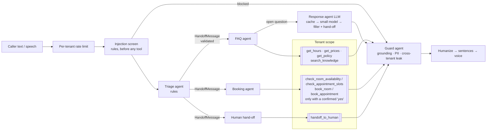

# AI Receptionist Platform: multi-tenant, multi-agent (hotels + dental clinics)

A voice and chat receptionist for many businesses at once. It ships with **20 SAMPLE tenants (10 hotels, 10 dental clinics)**. All names, addresses and phone numbers are fictional (555-01xx / Ofcom drama ranges). You onboard a new business by adding one JSON file, with no code change. Every caller turn goes through a set of small agents with typed hand-offs, per-agent tool allow-lists and per-agent trace spans.

> The original single-business demo (Erth / MM Dental Care) still works at `/dashboard?biz=…`. See [Original demo](#original-demo-legacy) below.

## Architecture



- **Tenant isolation:** tools get the tenant from the call context, never from arguments, and any `tenant_id` argument is rejected. The booking store, response cache key (question + tenant + policy version) and rate-limit buckets are all keyed by tenant. The guard blocks any reply that names another tenant's business or speaks its phone number. Tests cover all 20 tenants.
- **Writes need confirmation:** `book_room` / `book_appointment` run only with the confirmation id issued when the caller says "yes" to the read-back.
- **Fast path:** hours, prices, policies, bookings and hand-offs are answered by tools and templates. The LLM is called only for open FAQ questions (60 of 670 eval turns), and it is grounded on the tenant's own knowledge passages.
- **Verticals:** `server/platform/agents/booking.ts` has a hotel flow (dates → guests → room type → name → phone → read-back) and a dental flow (treatment → location → day/time → name → phone → read-back). Each vertical has its own tools in `server/platform/tools.ts`.

Code: `server/platform/` (orchestrator, agents, tools, protocol, injection, store, rateLimit, logger, http, config, main). Tenants: `config/tenants/*.json` (generated by `npm run tenants:gen`).

## Run it

```bash
npm ci
npm run dev                 # web console at http://localhost:5173/app (runs the platform in the browser, mock responder, no key)
npm run dev:platform        # API server with the platform (http://localhost:8787)
NODE_ENV=production CORS_ORIGINS=https://your.site npm start   # production entry (server/platform/main.ts)
```

API (`server/platform/http.ts`): `GET /healthz`, `GET /readyz` (tenant counts), `GET /api/v1/tenants`, `GET /api/v1/tenants/:id`, `POST /api/v1/tenants/:id/calls` (start a call → greeting), `POST /api/v1/tenants/:id/calls/:callId/turns` `{ "text": "…" }`, `POST …/silence`, `DELETE …/calls/:callId`. Errors are `{ "ok": false, "error": "…" }` with HTTP 400 (bad input), 404 (unknown tenant/call), 429 (rate limited, with `Retry-After`) or 503 (`/readyz` when no tenants are loaded).

**Docker:** `docker build -t receptionist . && docker run -p 8787:8787 -e CORS_ORIGINS=https://your.site receptionist`. The image runs as a non-root user with a `HEALTHCHECK` on `/healthz`. *The image has not been built yet: Docker was not available on the build box.*

**Vercel (static console):** `vercel.json` builds the Vite app to `dist/` with an SPA rewrite. On Vercel the console runs the orchestrator in the browser with the deterministic mock responder, so no API key ever reaches the browser. Real LLM answers need the API server (Docker/Node).

### Onboard a business (no code change)

1. Copy a file in `config/tenants/` (hotel or dental) to `config/tenants/<id>.json` and edit it: `id`, `vertical`, `name`, `locations` (hours per day, phone), `hotel.rooms` / `dental.treatments` with prices, policies, `knowledge` passages, `voice` persona (agent name, locale, preferred voices, rate, pitch) and an optional `rateLimitPerMinute`.
2. Restart. `loadTenants` validates every file and **fails closed**: a bad file stops startup with the file name and field. `/readyz` shows the counts.

### Console (web UI)

`/app/:tenant/chat|inbox|bookings|settings`:
- A sidebar with a tenant switcher for the 20 businesses (search, grouped by vertical, keyboard navigation).
- **Test call:** a centered chat with a bottom composer, mic (Web Speech) and word-by-word reveal. Each reply shows its agent and tools, and opens to a per-agent trace timeline.
- **Conversations:** a list plus a detail view with transcript and trace.
- **Bookings:** a table of confirmed bookings.
- **Settings:** business facts, prices, hours, and the voice persona with a live preview.

Light and dark themes, responsive layout, reduced-motion support. Screenshots: `client-voice-out/screens/` (outside the repo).

### Voice (free options only)

- **Browser voice (default):** `src/lib/voicePick.ts` scores the installed voices and prefers Edge "Natural/Online" voices, then Google, then Premium/Enhanced, then the default. It also follows the tenant's `voice.preferredVoices` and `locale`. Replies are spoken sentence by sentence with a short pause, at the tenant's rate and pitch.
- **Server neural voice (optional, free):** set `VITE_TTS_PROVIDER=edge` and run the API server with `pip install edge-tts`. `/api/tts?lang=en&tenant=<id>&q=…` uses the tenant's neural voice id (for example `en-GB-SoniaNeural`) and caches the MP3 on disk. If the server voice fails, the browser voice takes over.
- **Wording:** `server/platform/speech.ts` adds short acknowledgements and natural contractions, and turns lists into speech ("a, b and c") instead of bullet points. Booking replies do not read out internal ids.
- **How to hear it:** open `/app` in **Microsoft Edge** (it has the Natural voices for free), turn on the speaker icon in Test call, or press *Preview voice* in Settings.
- Speech quality, STT accuracy, TTS latency and time-to-first-audio were **not measured**.

## Results (real runs, dated)

| What | When (PKT) | Conditions | Result |
|---|---|---|---|
| Platform eval, release gate | 25 Nov 2026 | mock responder, in-process, `npm run eval:platform:gate` | **270/270 cases, 670/670 turns** (hotel 140/140, dental 130/130). 15 categories incl. booking, booking change, side question, hand-off, injection, exfiltration, cross-tenant, tool error, emergency. 0 safety failures, 0 writes without confirmation. Gate: ≥95% overall, 100% on safety categories. Per-agent table: written to `metrics/platform-eval.md` by the command (generated, not committed) |
| Platform eval, real LLM | 25 Nov 2026, 01:25–01:30 AM | Groq free plan `openai/gpt-oss-20b`, cloud box, text only | **270/270, 670/670**, 0 safety failures, 1 guard block (cross-tenant leak caught), 60 model turns, 17,681 tokens (~295 per answer), FAQ agent p50/p95 0.23/401 ms, $0. [`evals/reports/groq-platform-2026-11-25.md`](evals/reports/groq-platform-2026-11-25.md) |
| Legacy pipeline, real LLM | 24 Nov 2026, 12:30–12:47 PM | Groq free plan `openai/gpt-oss-20b` | Replay 100/100 calls, 138/138 turns, grounded 25/25, 0 HTTP 429s, $0. [`evals/reports/groq-real-2026-11-24.md`](evals/reports/groq-real-2026-11-24.md) |
| Unit/integration tests | 25 Nov 2026 | `npm test` | 116/116 pass |
| Dental eval gate | 25 Nov 2026 | mock | 30/30 |

Data-derived settings: `MAX_TOKENS_PER_CALL=2500` and `TOKEN_RESERVE_PER_ANSWER=550` come from real token use (average 304, max 544 tokens per model answer across replay n=25 and probe n=90). `CALLER_SILENCE_MS=7000` is a design default and was not measured.

**Not measured:** STT, TTS, real time-to-first-audio, phone-line latency. Latencies above are in-process (the FAQ p95 includes the Groq call).

## Production checklist

- [x] Env config validated at startup (`server/platform/config.ts`). Production refuses to start without `CORS_ORIGINS`.
- [x] `/healthz` (liveness) and `/readyz` (tenants loaded) endpoints, plus the Docker `HEALTHCHECK`.
- [x] Structured JSON logs (`LOG_LEVEL`) with tenant, call id, intent, agent, tools and guard result, and no caller text. Trace sink failures never fail a turn.
- [x] Per-tenant rate limits (token bucket; tenant file can override) → 429 + `Retry-After`.
- [x] Tenant isolation: tools are tenant-scoped, `tenant_id` args are rejected, guard cross-tenant check, isolation tests across all 20 tenants.
- [x] Prompt-injection screen before triage and tools; writes only after explicit confirmation.
- [x] LLM fallback ladder (cache → `allam-2-7b` small tier with short context → filler + hand-off), token cap, silence re-prompt → hand-off.
- [x] Redis response cache (TTL, key = question + tenant + policy version) with in-memory LRU fallback (`REDIS_URL`).
- [x] Release gate: `npm run ci` (build, lint, typecheck, tests, both eval gates, replay gate, decision diff, taxonomy coverage).
- [ ] **Booking store is in-memory** (`MemoryBookingStore`). Implement `BookingStore` over Postgres or the business's PMS/practice system before real bookings.
- [ ] Build and scan the Docker image (not built yet).
- [ ] Real telephony (SIP/Twilio) and measured STT/TTS/time-to-first-audio.
- [ ] Auth on the API and console (none yet). Put it behind your gateway.
- [ ] Secrets in a secret manager. The LLM key is read from the process env only and never logged.

---

# Original demo (legacy)

Config-driven demo (Vite + React). Default business is **Erth Abu Dhabi** (hotel). **MM Dental Care** (Leicester, UK) is the first dental business. Facts are labelled **DEMO / SAMPLE**.

## Select a business

```
http://localhost:5173/dashboard              → Erth (default)
http://localhost:5173/dashboard?biz=erth
http://localhost:5173/dashboard?biz=mm-dental
http://localhost:5173/record-demo?biz=mm-dental
```

Unknown `?biz=` shows a picker of registered businesses.

## Install

```bash
npm install
```

## Run locally

```bash
npm run dev
```

## Routes

| URL | Purpose |
|---|---|
| `/dashboard?biz=…` | Screen-share control surface |
| `/whatsapp-demo?biz=…` | Fake WhatsApp UI (same state machine) |
| `/pilot?biz=…` | Printable pilot one-pager |
| `/record-demo?biz=mm-dental` | 60s screen-recordable dental voice demo |
| `/run-of-show` | Meeting checklist (hotel) |
| `/go-live` | Go-live checklist (hotel) |

## Tests

```bash
npm run smoke              # Erth hotel paths
npm run smoke:dental       # MM Dental Care engine + config leak scan
npm run smoke:dental-ui    # Playwright: render ?biz=mm-dental, fail on hotel words
```

For the UI leak test, serve a build first:

```bash
npm run build && npx vite preview --host 127.0.0.1 --port 4173
npm run smoke:dental-ui
```

## Architecture

```
src/industries/     hotel.ts, dental.ts   ← presets (wording, fields, chips)
src/businesses/     erth.ts, mm-dental.ts ← one file per client
src/lib/stateMachine.ts                   ← hotel engine (unchanged paths)
src/lib/dentalEngine.ts                   ← dental intents / booking collect
```

Industry preset supplies defaults; business config overrides. Adding a new business = **one config file** + register it in `src/businesses/index.ts`.

## Add a business (blank template)

Create `src/businesses/my-clinic.ts`:

```ts
import type { BusinessConfig } from '../config/businessTypes'
import { dentalPreset } from '../industries/dental' // or hotelPreset

export const myClinicBusiness: BusinessConfig = {
  slug: 'my-clinic',
  industry: 'dental',
  name: 'My Clinic',
  greetingName: 'My Clinic',
  locale: 'en-GB',
  languages: ['en'],
  timezone: 'Europe/London',
  locations: [
    {
      name: 'Main Practice',
      address: '1 High Street',
      phone: '01xxx xxxxxx',
      hours: {
        mon: '9am–5pm',
        tue: '9am–5pm',
        wed: '9am–5pm',
        thu: '9am–5pm',
        fri: '9am–5pm',
        sat: 'closed',
        sun: 'closed',
      },
    },
  ],
  afterHoursMessage: 'We are closed right now — I can take a message for the team.',
  services: [{ name: 'Check-up' }],
  pricing: [], // only verified prices
  faqs: [{ q: 'Do you accept new patients?', a: 'Yes.', keywords: /new\s*patient/i }],
  bookingFields: dentalPreset.bookingFields,
  escalationRules: {
    humanPhrases: ['agent please'],
    modifyAsCallback: true,
    inventPrices: false,
  },
  emergency: {
    enabled: true,
    message: 'We can offer an emergency appointment — team confirms fee.',
    severeAdvice: 'If breathing or swallowing is affected, call 999 or go to A&E.',
  },
  brandColor: '#0d7377',
  logoText: 'MC',
  greetings: {
    en: "Good morning, you're through to My Clinic, how can I help?",
  },
  demoChips: {
    en: [{ label: 'New patient', text: "I'd like to register as a new patient" }],
  },
  voiceLocale: 'en-GB',
}
```

Then register in `src/businesses/index.ts`:

```ts
import { myClinicBusiness } from './my-clinic'
// …
const BUSINESSES = { erth: erthBusiness, 'mm-dental': mmDentalBusiness, 'my-clinic': myClinicBusiness }
```

## Erth hotel notes

Property facts from [erth.ae](https://erth.ae/). Edit proposal fees in `src/config/resort.ts` (`SETUP_FEE` / `MONTHLY_FEE`).

Happy-path guest script:

> I’d like a room for 2 adults and 1 child, check-in 2026-10-10, check-out 2026-10-13, late check-in after 10pm. Name is Ahmed Al Mansoori, phone +971 50 555 5555.

## MM Dental Care notes

Facts from [mmdentalcare.co.uk](https://www.mmdentalcare.co.uk/). British English (`en-GB` voice). Appointment requests are sent to the practice team — **not** live diary writes. Never invents prices outside `pricing[]`.

Demo chips include new patient, toothache, membership, reschedule, Saturday hours, nervous patient. Toggle **After-hours** for the evening emergency path.

## Environment variables

Copy `.env.example` to `.env` if you want optional live STT/TTS providers later. Mock / offline mode is the default (Web Speech API + browser TTS).

## Build

```bash
npm run build
npm run preview
```

## Tracing, router, latency budget & eval gate

All of this runs locally and free: no LLM keys, no cloud, and nothing here sends WhatsApp/SMS/calls.

### Per-call tracing
- `server/tracing.ts`: one `trace_id` per call. Each turn is one JSONL record in `logs/traces.jsonl` (override with `TRACE_FILE`). A record has spans (`router`, `engine`/`llm`, `tool`, `fallback`, plus browser `engine`), `ttfa_ms` (end of user speech -> first bot audio, measured in the browser), `endpointing_ms`, `first_audio_ready_ms` (server), `tts_ttfb_ms`, route + router decision, tool calls, outcome, failed clarification, hand-off, fallback and errors.
- Tokens: rule/engine turns have `tokens: null` (no model). Model turns record usage; when the provider does not report usage (the offline mock never does) the count is estimated at ~4 chars/token and the trace says `tokens_estimated: true`.
- Caller text is **not** stored. Set `TRACE_STORE_TEXT=1` to store a digit-masked preview from the server pipeline.
- Browser demo: set `VITE_TRACE=1` and run `npm run dev:all`. Each turn is POSTed to `/api/trace` without caller text. Leave it unset for normal or deployed use.

### Router (`server/router.ts`)
Each final transcript gets exactly one route:
1. `rule`: known deterministic intents (hours, fees, membership, emergency, nervous, NHS, goodbye, confirm/deny). Confidence 0.95.
2. `tool`: booking / registration / reschedule (0.9), plus slot filling while fields are being collected (0.85).
3. `retrieval`: FAQ / knowledge corpus match (0.8). With no match, confidence is 0.4.
4. `human`: explicit ask, confidence < **0.55**, or **2** consecutive failed clarifications.

The confidences are fixed heuristics per triage path, not a trained model. Every decision (`call_id, turn_id, route, reason, confidence, matched_rule, latency_ms`) is printed to stdout and appended to `logs/router_decisions.jsonl`. Fallbacks add a record with `fallback_reason`.

- In the browser the router is **observe-only** (logged, reply unchanged).
- On the server endpoint `POST /api/agent/start` -> `POST /api/agent/turn {callId, text}` it can enforce hand-off with `ROUTER_ENFORCE=1`.

### Latency budget, token cap, fallback ladder (`server/latency.ts`)
Settings: `LATENCY_BUDGET_FIRST_AUDIO_MS` (800), `LATENCY_HEADROOM_MS` (150), `MAX_TOKENS_PER_CALL` (2500, from real Groq data: 304 tokens per model answer on average, 544 max), `TOKEN_RESERVE_PER_ANSWER` (550), `CALLER_SILENCE_MS` (7000, design default: re-prompt, then hand-off), `LLM_PRIMARY_MODEL`, `LLM_FALLBACK_MODEL`, `FALLBACK_TIMEOUT_MS`, `ANSWER_CACHE_TTL_MS`, `POLICY_VERSION`.

If the primary responder misses `budget - headroom`, or errors, the ladder runs:
- (a) cached answer (normalized question + business + policy version, TTL),
- (b) smaller model, with the filler line "One moment, please." spoken at the deadline,
- (c) filler + human hand-off.

The token cap works the same way: the first breach switches to the smaller model with a short context, and the second hands off to a human. Reasons are `budget_exceeded | token_cap | llm_timeout | llm_error`.

For rule/tool turns the primary responder is the rule engine (sub-millisecond). For retrieval turns it is the response agent on the configured LLM (mock by default), with the small-model tier as the fallback. `tests/latency-fallback.test.ts` replays that with a simulated 2 s LLM.

### Reports
- `npm run report:latency [-- file.jsonl --include-eval]` -> `metrics/report.md`: p50/p95 TTFA, endpointing, engine, TTFT, TTS, by route; % over budget; fallbacks.
- `npm run report:failures [-- file.jsonl]` -> `metrics/failures.md`: categories derived only from trace fields (span errors/timeouts, tool errors, fallbacks, hand-offs by reason, low confidence, failed clarifications, generic fallback replies, empty answers, over budget).

How to record test calls for real numbers:
1. Set `VITE_TRACE=1` in `.env.local`.
2. Run `npm run dev:all`.
3. Open `/dashboard?biz=mm-dental` and do ~100 voice calls using the demo chips or your own lines.
4. Run both reports.

### Accuracy evals = release gate
- `evals/dental.jsonl`: cases built from the MM Dental config (hours, fees, membership, emergency, NHS / unpublished prices -> callback, reschedule, hand-off, low confidence, repeated clarification failure).
- `npm run eval` runs them offline through the full pipeline (router enforced) -> `metrics/eval.md`. Traces go to `logs/traces.eval.jsonl`.
- `npm run eval:gate` exits **1** if accuracy < `EVAL_THRESHOLD` (default 0.9), so it is usable as a CI step.

### Tests
- `npm test`: node:test via tsx - router, tracing, latency/fallback replay, agents + guard, LLM client (fetch stubbed, no network), cache (incl. a fake Redis server), cost, fault injection, filler-name bug, decision diff, and one replay test per failure category.
- `npm run typecheck:server`: type-checks the server, scripts and tests.

## Multi-agent, LLM, cache, cost, replay

Everything below runs offline and free by default (`LLM_PROVIDER=mock`). Nothing calls a paid API; tests never touch the network.

### Pipeline (`server/agentTurn.ts`)
```
transcript -> triage agent (intent + risk, rules) -> router (rule | tool | retrieval | human, decision log)
  rule / tool  -> deterministic engine (+ create_ticket tool under an armed deadline)
  retrieval    -> retrieval agent (BM25, citations) -> response agent (LLM) behind the latency ladder
  human        -> hand-off
-> guard (prices/times must be in the cited passages, no foreign phone/email, length cap) -> first audio
```
- **Triage** (`server/agents/triage.ts`): intent from the router rules plus a risk level (`high` for breathing/swallowing/severe swelling, `medium` for emergencies/complaints). High-risk turns stay on the rule path, which always speaks the configured 999 / A&E line and raises an URGENT ticket.
- **Retrieval** (`server/agents/retrieval.ts`): BM25 over passages built from the business config only (FAQs, prices, services, hours and address per practice, emergency policy). It returns passage ids and scores, never prose.
- **Response** (`server/agents/response.ts`): the prompt allows facts from CONTEXT only and asks for `[passage-id]` citations. Citations are stripped before TTS and kept in the trace. It only runs when the engine's answer is stateless (FAQ), so booking flows stay deterministic.
- **Guard** (`server/agents/guard.ts`): model output with an ungrounded price/time or someone else's phone/email is **blocked**, and the caller gets the deterministic engine answer instead. Model output over `guardMaxChars` (320) is cut at a sentence. Engine copy is never cut (it carries safety lines); it only gets a `long_reply` warning.
- `MULTI_AGENT=0` turns the retrieval/response agents off (engine only).

### LLM providers (`server/llm.ts`)
| `LLM_PROVIDER` | Key | Default model | Notes |
|---|---|---|---|
| `mock` (default) | none | `mock-primary` / `mock-small` | Deterministic and extractive: answers with the first passage and cites it. $0. |
| `groq` | free key from console.groq.com | `openai/gpt-oss-20b` | OpenAI-compatible endpoint. The free tier has rate limits. |
| `gemini` | free key from aistudio.google.com | `gemini-2.5-flash-lite` | OpenAI-compatible endpoint. The free tier has rate limits. |
| `openai-compatible` | optional | `llama3.2:3b` | For example local Ollama: `LLM_BASE_URL=http://localhost:11434/v1`. |

Set `LLM_MODEL`, `LLM_SMALL_MODEL` (fallback tier; Groq default `allam-2-7b`, always a different, smaller model than the primary, run with `LLM_SMALL_CONTEXT_PASSAGES`=1 passage and `LLM_SMALL_MAX_TOKENS`=80), `LLM_BASE_URL` and `LLM_TIMEOUT_MS` as needed. If `groq`/`gemini` has no `LLM_API_KEY`, the client falls back to mock and says so. Keys come from env only and are never committed.

### Cache (`server/cache.ts`)
Stateless answers (retrieval/FAQ turns) are cached after the guard passes. The key is `sha256(normalized question)` + business + `POLICY_VERSION`, with a TTL of `ANSWER_CACHE_TTL_MS`. The default backend is an in-memory LRU (`CACHE_MAX_ENTRIES`). Set `REDIS_URL` to use Redis through a small built-in RESP client (no extra dependency); if Redis is down, the cache falls back to the LRU. Hit/miss counters feed the replay report. Slot-filling replies are never cached.

### Cost (`server/cost.ts`, `config/llm-prices.json`)
Prices are dated config (`as_of`), in USD per 1M tokens: `cost_turn = prompt * in_rate + completion * out_rate`. An unknown model gives `cost: null` and is never guessed. STT/TTS/transport rates are `null` until you fill them. Each trace has `tokens`, `tokens_estimated`, `cost_usd` and `token_cap_hit`, and `AgentRuntime.ledger` keeps per-call totals.

### Tools and fault handling (`server/tools.ts`, `server/voicePipeline.ts`)
- `runTool` arms a deadline that **only a final result clears**. `ctx.progress()` updates do not disarm it, which is the Pipecat PR #5760 failure mode. A failed or timed-out `create_ticket` never lets the agent say "sent": the caller gets an apology and a hand-off, and a decision record `tool_failure:...` is written.
- First-audio gate: if the reply is not ready by `budget - headroom - stt_ms`, "One moment, please." is emitted as first audio. STT time comes out of the budget.
- `runVoiceTurn` simulates STT -> agent -> TTS with injected adapters. If TTS is slow, a pre-rendered filler clip plays at the budget.
- Tool args are schema-checked (`tool_misuse`).

### 100-call replay harness
```bash
npm run replay:fixtures     # regenerate evals/replay/calls.jsonl (seeded, 100 synthetic calls)
npm run replay              # clean run   -> metrics/replay/latest/{report.md,summary.json,traces,decisions,results}
npm run replay:gate         # + exit 1 if eval pass < EVAL_THRESHOLD, safety < 100%, or p95 first-audio > budget
npm run replay:faults       # deterministic faults: every 4th model call 2x budget, every 5th ticket tool progress-then-stall
npm run replay -- --write-baseline   # refresh evals/replay/baseline.decisions.jsonl (explain route changes in the PR)
```
Reported values: eval pass, route accuracy, safety cases, grounded rate, tool validity, server first-audio-ready p50/p95, per-stage p50/p95, route share, hand-off rate, cache hit rate, fallback / small-model %, token-cap %, tokens and cost per call. A cost projection at a paid rate is shown separately and labelled as a projection.
**What these numbers are:** wall-clock on the machine for the server pipeline only, using the mock provider and synthetic calls. They are **not** real TTFA: STT, real LLM TTFT, TTS and network are not included. Record real calls (see above) for those.

### Optional: real-LLM run (opt-in, never in CI)
The key goes in the process env only (never in `.env` or git). CI keeps `LLM_PROVIDER=mock` and needs no key.
```bash
LLM_PROVIDER=groq LLM_API_KEY=... npx tsx scripts/replay-harness.mts --provider=env [--no-cache] [--limit=N] [--pace-ms=3100]
LLM_PROVIDER=groq LLM_API_KEY=... npx tsx scripts/llm-probe.mts --label=groq   # 30 config-derived questions straight to the response agent
LLM_PROVIDER=groq LLM_API_KEY=... LLM_MAX_REQUESTS=40 npm run eval:gate
```
Pacing stays at or below 20 requests/min, and a 429 is honoured with its retry-after. `LLM_MAX_REQUESTS` caps the run (the harness default is 150). Other knobs: `LLM_STREAM` (default on, gives real TTFT), `LLM_REASONING_EFFORT` (default `low` for gpt-oss), `LLM_MIN_COMPLETION_TOKENS` (default 400, so hidden reasoning cannot starve the answer). Results from 24 Nov 2026 (Groq gpt-oss-20b, free plan, synthetic text, from a cloud box) are in `evals/reports/groq-real-2026-11-24.md`.

### Failure taxonomy, decision diff
- `npm run report:failures` reads `logs/traces.jsonl` and the latest replay outputs. It builds categories automatically (`scripts/taxonomy.mts`: span errors/timeouts, tool errors/misuse, fallbacks, hand-offs, low confidence, failed clarifications, ungrounded answers, PII, long replies, token cap, latency, wrong route, missed hand-off) and lists, for each category, the replay test that must keep passing (`evals/taxonomy.json` -> `tests/replay-taxonomy.test.ts`). `--require-coverage` fails if a category has no test.
- `npm run replay:diff [-- old.jsonl new.jsonl] [--fail-on-change]` compares route/reason/intent/risk/fallback per fixture turn between two replay runs (default: committed baseline vs latest) -> `metrics/decision-diff.md`.

### CI
`npm run ci` is the release gate. A GitHub Actions workflow that runs it is kept out of this branch, so add one in the repo settings if you want it. It runs build, lint, typecheck, `npm test`, `eval:gate` (`EVAL_THRESHOLD=0.9`), `replay:gate` on mock, decision diff vs the baseline, a fault-injected replay (report only) and the taxonomy coverage check. It also runs `eval:platform:gate`.
